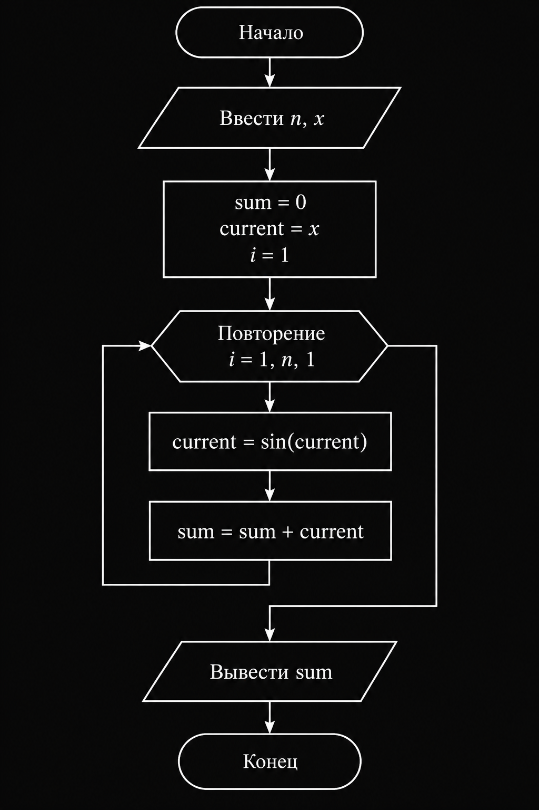

# Лабораторная работа 8

## Вариант 9. Вложенные синусы

### Постановка задачи

Вычислить для заданного натурального `n` и действительного `x` значение:

sin(x) + sin(sin(x)) + ... + sin(sin(...sin(x)))

где вложение синуса выполняется `n` раз.

Для вычисления необходимо использовать цикл `for`.

### Программа

Программа получает от пользователя значения `n` и `x`.

На каждом шаге цикла вычисляется новое значение:

current = sin(current)

После этого полученное значение добавляется к сумме:

sum = sum + current

После выполнения `n` повторений программа выводит итоговую сумму.

### Блок-схема

### Исходный код

Исходный код программы находится в файле `main.c`.
